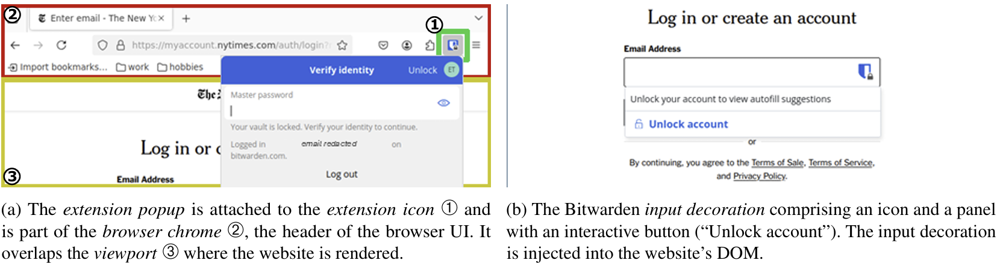
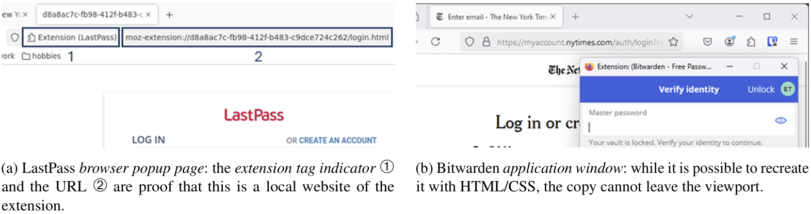
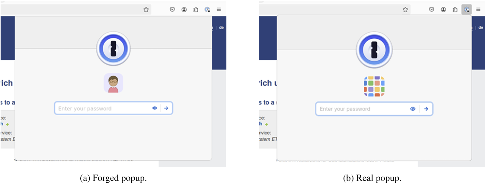
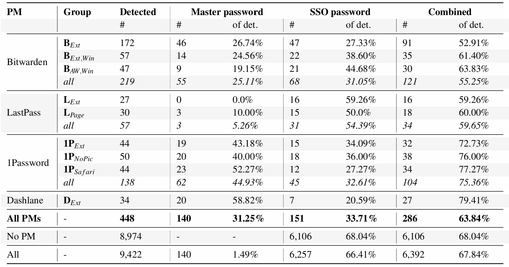

## 1. 논문 소개

| 구분 | 내용 |
|---|---|
| 논문 제목 | Phishing Attacks against Password Manager Browser Extensions |
| 저자 | Claudio Anliker, Daniele Lain, Srdjan Čapkun |
| 소속 | ETH Zurich |
| 학회 | 34th USENIX Security Symposium |
| 게재 연도 | 2025년 |
| 페이지 | 7857–7876 |
| 연구 분야 | Web Security, Phishing, Usable Security |

- 공식 학회 페이지: https://www.usenix.org/conference/usenixsecurity25/presentation/anliker
- 논문 원문: https://www.usenix.org/system/files/usenixsecurity25-anliker.pdf

### 논문 선정 이유

일반적으로 피싱 공격이라고 하면 정상적인 웹사이트와 유사한 가짜 웹사이트를 만들어 사용자의 개인정보를 탈취하는 공격을 떠올린다. 그러나 이 논문에서는 피싱을 예방하기 위해 사용하는 비밀번호 관리자 자체가 공격 대상이 될 수 있다는 점이 흥미로웠다.

특히 프로그램 내부의 취약점이나 암호화 알고리즘의 결함이 아닌, 브라우저의 인터페이스 구조와 사용자의 행동을 이용한다는 점에서 기존에 공부했던 보안 취약점과는 다른 접근 방식이라고 생각하였다.

또한 실제 사용자를 대상으로 진행한 대규모 실험이 포함되어 있어 공격의 원리뿐만 아니라 현실적인 위험성과 대응 방안까지 살펴볼 수 있을 것 같아 해당 논문을 선정하였다.

---

## 2. 연구 배경 및 문제 정의

### 2.1. 비밀번호 관리자(Password Manager)

비밀번호 관리자(Password Manager, 이하 PM)는 사용자가 여러 웹사이트에서 사용하는 비밀번호를 생성하고 저장하며, 로그인할 때 자동으로 입력해 주는 프로그램이다.

대표적인 비밀번호 관리자로는 Bitwarden, LastPass, 1Password, Dashlane 등이 있다.

사용자는 웹사이트마다 서로 다른 비밀번호를 설정하더라도 모든 비밀번호를 기억할 필요가 없다. 대신 비밀번호 저장소(Password Vault)에 접근하기 위한 마스터 비밀번호(Master Password)를 관리한다.

비밀번호 관리자의 주요 장점은 다음과 같다.

- 복잡하고 안전한 비밀번호 생성
- 웹사이트마다 서로 다른 비밀번호 사용
- 여러 계정의 비밀번호를 효율적으로 관리
- 웹사이트 주소에 기반한 자동 완성 기능을 통한 피싱 예방

특히 비밀번호 관리자는 저장된 웹사이트 주소와 현재 접속한 웹사이트 주소를 비교하여 비밀번호를 자동으로 입력한다. 따라서 정상적인 웹사이트와 유사한 가짜 웹사이트에 접속하더라도 비밀번호가 자동으로 입력되지 않아 피싱 공격을 알아차리는 데 도움이 된다.

하지만 여러 계정의 인증 정보를 하나의 저장소에서 관리하기 때문에 마스터 비밀번호가 공격자에게 노출될 경우 피해가 여러 계정으로 확대될 수 있다.

### 2.2. 기존 피싱 방어 방식의 한계

일반적인 피싱 공격은 정상적인 웹사이트의 로그인 화면을 위조하여 사용자의 비밀번호를 탈취하는 방식으로 이루어진다.

이러한 공격을 예방하기 위해 사용자에게 웹사이트의 URL을 확인하도록 권장하거나 비밀번호 관리자의 자동 완성 기능을 활용한다.

그러나 공격자가 웹사이트의 로그인 화면이 아닌 비밀번호 관리자의 인터페이스 자체를 위조한다면 기존 방어 방식만으로는 공격을 알아차리기 어려울 수 있다.

하지만 실제 사용자가 이러한 공격에 얼마나 취약한지, 비밀번호 관리자의 인터페이스에 따라 공격 결과가 달라지는지에 대한 체계적인 연구는 부족하였다.

이에 저자들은 비밀번호 관리자 확장 프로그램을 대상으로 한 피싱 공격의 실효성을 검증하고자 하였다.

### 2.3. 연구 질문(Research Questions)

논문에서는 다음 세 가지 연구 질문을 설정하였다.

| 연구 질문 | 내용 |
|---|---|
| RQ1 | 비밀번호 관리자 확장 프로그램을 대상으로 한 피싱 공격은 실제로 효과적인가? |
| RQ2 | 비밀번호 관리자의 인터페이스 설계가 공격 성공률에 영향을 미치는가? |
| RQ3 | 특정 사용자 집단이 이러한 피싱 공격에 더 취약한가? |

이러한 질문을 통해 공격이 기술적으로 가능하다는 사실을 확인하는 것에서 나아가, 실제 사용자 환경에서도 위협이 될 수 있는지를 분석하는 것이 연구의 목적이다.

---

## 3. 핵심 아이디어 및 공격 원리

### 3.1. 브라우저 인터페이스의 구조

논문에서 제시하는 공격을 이해하기 위해서는 먼저 웹 브라우저의 인터페이스 구조를 알아야 한다.

브라우저의 화면은 크게 Browser Chrome과 Viewport로 나뉜다.

**Browser Chrome**

브라우저가 직접 관리하는 영역으로 주소창, 북마크, 확장 프로그램 아이콘 등이 포함된다. 일반적인 웹사이트에서는 해당 영역을 직접 수정할 수 없으므로 신뢰할 수 있는 영역으로 간주된다.

**Viewport**

웹사이트의 콘텐츠가 표시되는 영역이다. 웹사이트는 HTML, CSS, JavaScript 등을 이용하여 해당 영역에 표시되는 내용을 제어할 수 있다.

*Figure 1. 비밀번호 관리자 확장 프로그램의 주요 UI 구성 요소 (출처: Anliker et al., 2025)*

문제는 비밀번호 관리자 확장 프로그램에서 제공하는 팝업이 신뢰할 수 있는 브라우저 인터페이스에 속하더라도 화면상으로는 Viewport 위에 겹쳐서 표시된다는 것이다.

따라서 웹사이트 내부에서 유사한 화면을 만들어 표시하면 사용자는 실제 확장 프로그램과 위조된 화면을 구분하기 어려울 수 있다.

논문에서는 이러한 문제를 Trusted UI Confusion, 즉 신뢰할 수 있는 사용자 인터페이스와 신뢰할 수 없는 인터페이스 사이의 혼동으로 설명한다.

*Figure 2. 비밀번호 관리자의 브라우저 팝업 페이지와 애플리케이션 창 (출처: Anliker et al., 2025)*

비밀번호 관리자마다 인증 화면을 제공하는 방식에는 차이가 있다. 위 그림에서 LastPass는 브라우저 팝업 페이지를 사용하고, Bitwarden은 별도의 애플리케이션 창을 사용한다. 이러한 방식에서도 인증 화면이 웹사이트 콘텐츠 영역과 시각적으로 겹칠 수 있다는 문제가 존재한다.

### 3.2. 실제 인터페이스와 위조 인터페이스

논문의 Figure 3에서는 1Password의 실제 팝업과 위조된 팝업을 비교한다.

*Figure 3. 1Password의 위조된 팝업(a)과 실제 팝업(b) 비교 (출처: Anliker et al., 2025)*

두 화면은 전체적인 디자인과 비밀번호 입력창의 위치 등에서 매우 유사하지만 몇 가지 차이점이 존재한다.

| 실제 팝업 | 위조된 팝업 |
|---|---|
| 브라우저 확장 프로그램에서 생성 | 웹사이트 내부에서 생성 |
| 확장 프로그램 아이콘이 활성화됨 | 실제 확장 프로그램 아이콘은 활성화되지 않음 |
| 브라우저 상단 영역과 겹칠 수 있음 | Viewport 내부에만 표시 가능 |
| 실제 사용자 프로필 사진 표시 가능 | 실제 프로필 사진을 알기 어려움 |

기술적인 관점에서는 두 인터페이스의 차이를 구분할 수 있지만, 사용자가 웹사이트에 로그인하는 과정에서 이러한 세부적인 차이까지 확인하기는 쉽지 않다.

공격자는 이러한 시각적 유사성을 이용하여 사용자가 위조된 팝업을 정상적인 비밀번호 관리자로 인식하도록 유도한다.

### 3.3. 사용자 주의 분산

이 공격의 또 다른 특징은 사용자의 관심이 비밀번호 관리자 자체에 집중되어 있지 않다는 점이다.

사용자의 원래 목적은 특정 웹사이트에 로그인하는 것이다. 비밀번호 관리자의 잠금을 해제하는 행동은 로그인 과정에서 발생하는 부수적인 절차에 해당한다.

따라서 사용자는 비밀번호 관리자의 화면이 정상적인지 확인하기보다는 빠르게 잠금을 해제하고 웹사이트에 로그인하려 할 수 있다.

이처럼 공격은 기술적인 구조뿐만 아니라 사용자의 평소 이용 습관과 주의 분산을 활용한다.

또한 공격자가 정상적인 웹사이트를 침해하여 공격을 수행하는 경우에는 웹사이트의 URL 자체가 정상적일 수 있다. 이때는 URL을 확인하는 기존의 피싱 방어 방식만으로 공격을 탐지하기 더욱 어려워진다.

### 3.4. 일반적인 피싱 공격과의 차이점

| 구분 | 일반적인 피싱 | 논문에서 분석한 피싱 |
|---|---|---|
| 위조 대상 | 웹사이트 로그인 화면 | 비밀번호 관리자 인터페이스 |
| 주요 공격 대상 | 개별 계정의 비밀번호 | 마스터 비밀번호 |
| 악용하는 요소 | 웹사이트에 대한 신뢰 | 보안 프로그램에 대한 신뢰 |
| 잠재적인 피해 범위 | 해당 계정 중심 | 저장된 여러 계정으로 확대 가능 |
| URL 확인의 효과 | 공격 탐지에 도움이 됨 | 충분하지 않을 수 있음 |

이 공격은 비밀번호 관리자의 암호화 기능이나 저장소를 직접 공격하는 방식이 아니다. 사용자가 신뢰하는 인터페이스를 모방하여 민감한 인증 정보를 입력하도록 유도하는 방식이다.

---

## 4. 연구 방법 및 실험 설계

### 4.1. 공격 방식

논문 Section 4에서는 비밀번호 관리자 확장 프로그램을 대상으로 한 공격을 크게 세 단계로 설명한다.

**Step 1. 비밀번호 관리자 식별(Detecting the PM)**

사용자의 브라우저에서 어떤 종류의 비밀번호 관리자를 사용하고 있는지 파악하는 단계이다.

비밀번호 관리자 확장 프로그램은 로그인 입력창에 자체적인 인터페이스 요소를 추가하는 경우가 있다. 연구진은 이러한 브라우저 화면 구성의 변화를 통해 비밀번호 관리자를 구분할 수 있다는 점을 확인하였다.

**Step 2. 정상 인터페이스의 개입 방지(Suppressing the PM)**

실제 비밀번호 관리자가 제공하는 인터페이스와 위조된 인터페이스가 동시에 표시되면 사용자가 이상함을 알아차릴 수 있다.

따라서 연구진은 실험 환경에서 정상적인 비밀번호 관리자의 입력 보조 기능이 위조된 인터페이스와 충돌하지 않도록 구성하였다.

**Step 3. 위조 인터페이스 표시(Forging the PM)**

식별된 비밀번호 관리자의 디자인을 모방한 화면을 제공한다.

사용자가 해당 화면을 실제 비밀번호 관리자의 잠금 해제 화면으로 인식하고 비밀번호를 입력하는지를 측정한다.

이러한 방식에서 실제 비밀번호 관리자의 내부 권한을 획득하거나 암호화를 해제하는 과정은 필요하지 않다. 브라우저의 시각적인 구조와 사용자의 신뢰를 이용한다는 것이 공격의 핵심이다.

### 4.2. 실험 대상 및 환경

연구진은 다음 네 가지 비밀번호 관리자 확장 프로그램을 대상으로 공격을 구현하였다.

- Bitwarden
- LastPass
- 1Password
- Dashlane

각 비밀번호 관리자는 서로 다른 로그인 인터페이스와 잠금 해제 방식을 사용한다.

연구진은 이러한 차이가 사용자의 공격 탐지 여부와 비밀번호 입력 비율에 어떤 영향을 미치는지 비교하였다.

실험은 총 29,809명의 대학 구성원을 대상으로 진행되었다.

연구진은 기관의 통합 로그인 시스템인 SSO(Single Sign-On)를 모방한 실험용 웹사이트를 사용하였으며, 대상 비밀번호 관리자의 사용 여부에 따라 서로 다른 인터페이스를 제공하였다.

### 4.3. 평가 방법

실험에서는 사용자가 위조된 비밀번호 관리자 화면에 마스터 비밀번호를 입력하는지를 중심으로 공격의 효과를 평가하였다.

또한 마우스 움직임과 클릭 등의 사용자 행동을 분석하고 실험 이후 설문조사를 진행하였다.

이를 통해 다음과 같은 내용을 확인하고자 하였다.

- 비밀번호 관리자별 공격 성공률
- 사용자가 위조 인터페이스를 인식하는지 여부
- 인터페이스의 시각적 차이가 공격 성공률에 미치는 영향
- 사용자의 전공, 연령, 운영체제 및 브라우저에 따른 차이

### 4.4. 연구 윤리

실제 사용자를 대상으로 피싱 실험을 진행하기 때문에 개인정보 보호와 연구 윤리 역시 중요한 부분이다.

연구진은 소속 기관의 연구윤리위원회(IRB)와 관련 기관의 승인을 받아 실험을 진행하였다.

실험 과정에서 실제 비밀번호는 수집하지 않았으며, 사용자가 입력한 비밀번호는 브라우저에서 폐기하였다. 대신 입력된 비밀번호의 길이와 연속된 로그인 시도 사이의 유사성 등 제한적인 정보만 기록하였다.

실험 종료 후에는 참여자들에게 피싱 시뮬레이션의 목적과 진행 사실을 안내하였다.

이러한 실험 방식은 실제 공격의 위험성을 확인하면서도 참여자에게 발생할 수 있는 피해를 최소화했다는 점에서 의미가 있다고 생각한다.

---

## 5. 실험 결과 및 평가

### 5.1. 전체 실험 결과

논문의 실험 결과는 다음과 같다.

| 구분 | 인원 |
|---|---:|
| 전체 피싱 실험 대상 | 29,809명 |
| 분석 대상 웹사이트 방문자 | 9,422명 |
| 대상 비밀번호 관리자 감지 | 448명 |
| 마스터 비밀번호 입력 | 140명 |

대상 비밀번호 관리자가 감지된 448명 중 140명이 위조된 인터페이스에 마스터 비밀번호를 입력한 것으로 분류되었다.

이를 바탕으로 공격 성공률을 계산하면 다음과 같다.

Attack Success Rate = (140 / 448) × 100 = 31.25%

즉, 대상 비밀번호 관리자가 감지된 사용자 중 약 3명에 1명꼴로 공격에 노출된 것이다.

여기서 주의할 점은 31.25%가 전체 실험 대상자 29,809명을 기준으로 한 수치가 아니라 대상 비밀번호 관리자 사용자 448명을 기준으로 계산한 수치라는 것이다.

또한 실제 비밀번호를 수집하거나 계정을 탈취한 것이 아니므로 해당 수치를 실제 계정 탈취 성공률로 해석해서는 안 된다.

### 5.2. 비밀번호 관리자별 공격 성공률

논문의 Table 2에서는 비밀번호 관리자별 공격 성공률을 다음과 같이 제시한다.

*Table 2. 비밀번호 관리자별 피싱 실험 결과 (출처: Anliker et al., 2025)*

| 비밀번호 관리자 | 감지 인원 | 입력 인원 | 공격 성공률 |
|---|---:|---:|---:|
| Bitwarden | 219명 | 55명 | 25.11% |
| LastPass | 57명 | 3명 | 5.26% |
| 1Password | 138명 | 62명 | 44.93% |
| Dashlane | 34명 | 20명 | 58.82% |
| 전체 | 448명 | 140명 | 31.25% |

출처: 논문 Table 2, p.7864.

Dashlane의 공격 성공률이 58.82%로 가장 높았으며, 1Password가 44.93%로 그 뒤를 이었다. 반면 LastPass의 공격 성공률은 5.26%로 상대적으로 낮았다.

하지만 이러한 결과만으로 Dashlane이 가장 취약하고 LastPass가 가장 안전한 비밀번호 관리자라고 판단할 수는 없다.

저자들은 LastPass 사용자 57명 중 46명이 위조된 입력 보조 아이콘을 선택하지 않아 위조 로그인 화면 자체를 보지 않았다는 점을 확인하였다.

따라서 LastPass의 낮은 마스터 비밀번호 입력 비율을 사용자가 피싱 공격을 성공적으로 탐지한 결과라고 단정하기는 어렵다.

제품별 실험 인원뿐만 아니라 비밀번호 관리자의 이용 습관과 사용자 행동 역시 공격 성공률에 영향을 미칠 수 있기 때문이다.

### 5.3. 인터페이스 설계에 따른 영향

연구진은 팝업의 형태와 프로필 사진 등 인터페이스의 시각적인 차이가 공격 성공률에 영향을 미치는지도 분석하였다.

1Password 사용자를 대상으로 실제 프로필 사진 대신 기본 이미지를 표시하거나 프로필 사진을 제거하는 조건을 비교하였으나, 이러한 차이가 공격 성공률을 뚜렷하게 감소시키지는 못하였다.

일부 사용자는 인터페이스의 시각적인 차이를 알아차리고도 비밀번호를 입력하였다.

이는 정상적인 인터페이스에 시각적 특징을 추가하는 것만으로 사용자가 위조된 화면을 구분하도록 만드는 데 한계가 있음을 보여준다.

### 5.4. 사용자 배경에 따른 영향

연구에서는 IT, 컴퓨터공학, 전기공학 관련 구성원 또한 해당 공격에 취약한 모습을 보였다.

실험 대상 집단 내에서는 연령, 전공, 운영체제 및 브라우저에 따른 뚜렷한 차이가 확인되지 않았다.

다만 이러한 결과가 보안 지식이나 연령이 공격 성공률에 전혀 영향을 미치지 않는다는 것을 의미하지는 않는다. 연구 대상과 표본의 범위 내에서 유의미한 차이를 확인하지 못한 것으로 해석해야 한다.

개인적으로는 이 결과가 가장 인상 깊었다. 기술적인 지식을 가진 사용자도 익숙한 인터페이스에 대한 신뢰 때문에 공격에 노출될 수 있다는 점에서 사용자 교육만으로는 해결하기 어려운 문제라고 생각하였다.

---

## 6. 논문에서 논의한 대응 방안 및 한계

논문의 Section 7.1에서는 마스터 비밀번호 유출로 인한 피해를 줄이는 방법과 인터페이스 위조 문제를 개선하는 방법을 논의한다.

다만 본 논문은 새로운 방어 시스템을 구현하고 그 효과를 검증하는 연구가 아니라, 공격의 실효성과 기존 대응 방식의 한계를 분석하는 연구이다.

### 6.1. 다중 인증(Multi-Factor Authentication)

마스터 비밀번호가 유출되더라도 추가적인 인증 절차를 요구함으로써 공격자가 비밀번호 관리자 계정에 접근하는 것을 어렵게 만들 수 있다.

그러나 OTP나 승인 요청을 이용한 인증 방식은 사용자에게 추가 인증 정보까지 요구하는 실시간 피싱 공격에 노출될 수 있다.

FIDO2 기반 보안 키와 같이 피싱에 강한 인증 방식은 이러한 위험을 줄일 수 있다.

하지만 보안 키를 분실했을 때 계정을 복구할 수 있어야 하므로, 복구 과정에서 상대적으로 취약한 인증 방식으로 전환된다면 다시 피싱 공격이 발생할 가능성이 있다.

### 6.2. 패스키(Passkey) 도입

저자들은 기존 비밀번호를 대체하는 인증 방식으로 패스키를 논의하였다.

패스키는 공개키 암호 기술을 활용하여 인증을 수행하므로 사용자가 위조된 화면에 기존 비밀번호를 입력하는 형태의 공격을 줄일 수 있다.

그러나 비밀번호를 완전히 대체하기까지는 시간이 필요하며, 계정 복구 과정에서 기존 비밀번호 등의 인증 수단을 사용한다면 여전히 피싱 위험이 남아 있다.

### 6.3. 신뢰 영역과 비신뢰 영역의 분리

브라우저 화면에서 신뢰할 수 있는 인터페이스와 웹사이트가 제어하는 인터페이스를 명확하게 분리하는 방법이다.

저자들은 비밀번호 관리자의 인터페이스를 브라우저 상단의 Browser Chrome 영역으로 완전히 이동시키는 방안을 논의하였다.

또한 웹사이트 내부의 입력 보조 인터페이스를 제거하거나 상호작용할 수 없도록 변경하여 사용자가 브라우저의 실제 확장 프로그램 아이콘을 통해 비밀번호 관리자를 실행하도록 하는 방법도 고려하였다.

다만 이러한 변경은 사용 편의성을 떨어뜨릴 수 있으며, 웹사이트에 위조된 화면이 나타났을 때 사용자가 이를 무시할 것인지에 대해서는 추가 검증이 필요하다.

### 6.4. 개인화된 인터페이스 및 보안 표시

프로필 사진과 같이 사용자별로 다른 정보를 인터페이스에 표시하면 공격자가 실제 화면을 완벽하게 모방하기 어려워질 수 있다.

그러나 앞선 실험에서는 프로필 사진이 제거되거나 변경되더라도 공격 성공률이 뚜렷하게 감소하지 않았다.

확장 프로그램의 아이콘 활성화 여부나 주소창에 표시되는 확장 프로그램 정보 역시 정상적인 인터페이스인지 판단하는 단서가 될 수 있지만, 사용자가 이러한 표시를 충분히 확인하지 않을 가능성이 존재한다.

결과적으로 저자들은 현재의 브라우저 인터페이스 구조와 사용자 행동을 고려할 때 단순한 UI 변경이나 추가 인증 수단만으로 해당 공격을 완전히 해결하기 어렵다고 보았다.

---

## 7. 연구의 한계 및 개인적인 분석

### 7.1. 실험 대상의 대표성

이번 연구는 약 3만 명을 대상으로 진행한 대규모 실험이라는 점에서 의미가 있다.

그러나 실험 대상이 특정 대학의 구성원으로 제한되어 있다는 한계가 존재한다.

대학생과 교직원 중심의 연구 대상은 일반 인터넷 사용자와 연령 분포, 기술적 지식, 인터넷 사용 습관 등에서 차이가 있을 수 있다.

따라서 다양한 연령대와 직업군을 대상으로 동일한 실험을 진행한다면 연구 결과를 더욱 일반화할 수 있을 것이라고 생각한다.

### 7.2. 비밀번호 관리자별 표본 수 차이

실험에서 감지된 Bitwarden 사용자는 219명이지만 Dashlane 사용자는 34명에 불과하다.

이처럼 제품별 표본 수에 차이가 있기 때문에 공격 성공률만으로 각 비밀번호 관리자의 보안성을 비교하는 것은 적절하지 않다.

또한 사용자마다 비밀번호 관리자를 이용하는 방식이 다르기 때문에 인터페이스 설계의 영향과 사용 습관의 영향을 구분하기 어렵다.

제품별로 비슷한 수의 사용자를 모집하고 동일한 조건에서 실험을 진행한다면 인터페이스의 차이가 공격 결과에 미치는 영향을 더욱 정확하게 분석할 수 있을 것이다.

### 7.3. 실제 계정 탈취 여부를 확인하지 않았다는 점

연구진은 연구 윤리상의 이유로 실제 비밀번호를 수집하지 않았다.

따라서 연구에서 측정한 공격 성공률은 위조된 인터페이스에 마스터 비밀번호를 입력한 비율이며, 공격자가 해당 정보를 이용해 실제 계정에 접근할 수 있는지를 검증한 것은 아니다.

다중 인증이나 기기 인증이 적용된 환경에서는 실제 피해 가능성이 달라질 수 있다.

연구의 목적을 고려하면 적절한 실험 방식이지만, 가상의 테스트 계정을 이용하여 추가 인증 수단에 따른 피해 범위를 비교하는 별도의 실험이 이루어진다면 보다 구체적인 위험성 분석이 가능할 것이라고 생각한다.

### 7.4. 대응 방안의 효과에 대한 추가 검증 필요

논문에서는 신뢰 영역의 분리, 패스키, 다중 인증 등 여러 대응 방향을 논의하였다.

하지만 개선된 인터페이스를 새롭게 구현하고 기존 인터페이스와 비교하는 대규모 실험은 진행하지 않았다.

따라서 어떠한 인터페이스 설계가 사용자에게 가장 명확한 보안 정보를 제공하는지는 여전히 해결해야 할 문제로 남아 있다.

개인적으로는 공격 성공률뿐만 아니라 사용자가 정상적인 화면과 위조된 화면을 구분하는 데 걸리는 시간, 인증 과정에서 느끼는 불편함 등을 함께 측정하는 후속 연구가 이루어지면 좋겠다고 생각한다.

---

## 8. 향후 확장 가능성 및 후속 연구 계획

### 8.1. 추가로 읽어보고 싶은 논문

**Is Real-Time Phishing Eliminated with FIDO? Social Engineering Downgrade Attacks against FIDO Protocols**

- 학회: USENIX Security Symposium 2021
- 저자: Enis Ulqinaku, Hala Assal, AbdelRahman Abdou, Sonia Chiasson, Srdjan Čapkun

이번 논문의 참고문헌 [45]에 포함된 연구로, 피싱에 강한 FIDO 인증 방식에서도 상대적으로 취약한 인증 방식으로 전환하도록 사용자를 유도하는 공격을 다룬다.

이번 논문에서 다중 인증과 패스키가 대응 방안으로 언급되었지만 계정 복구 등의 과정에서 한계가 발생할 수 있다는 점에 관심이 생겼다.

따라서 해당 논문을 추가로 읽으며 안전한 인증 기술을 사용하더라도 전체 인증 과정의 설계가 적절하지 않으면 발생할 수 있는 보안 문제를 공부하고 싶다.

### 8.2. 암호화폐 지갑 확장 프로그램으로의 확장

논문을 읽으면서 비밀번호 관리자와 유사한 형태로 동작하는 암호화폐 지갑 확장 프로그램에도 이러한 문제가 발생할 수 있다고 생각하였다.

MetaMask와 같은 브라우저 기반 암호화폐 지갑 역시 웹사이트를 이용하는 과정에서 별도의 인터페이스를 통해 사용자 인증과 트랜잭션 승인을 요청한다.

비밀번호 관리자와 암호화폐 지갑은 관리하는 정보와 수행하는 기능에 차이가 있지만, 사용자가 인터페이스를 신뢰하고 민감한 작업을 수행한다는 공통점이 있다.

따라서 두 프로그램의 인증 화면과 팝업 구조를 비교하고, 사용자가 화면의 출처를 정확하게 인식할 수 있는지 분석해보고 싶다.

특히 비밀번호 관리자는 마스터 비밀번호를 보호하는 것이 중요하지만 암호화폐 지갑에서는 개인키, 복구 구문, 트랜잭션 승인 과정 등의 보호도 중요하므로 각 시스템에 적합한 보안 설계가 필요할 것이라고 생각한다.

### 8.3. 직접 구현해보고 싶은 프로젝트

**프로젝트 주제: 브라우저 확장 프로그램의 신뢰 영역 분석 및 보안 인터페이스 개선**

이번 논문에서 다룬 문제를 직접 이해하기 위해 브라우저 확장 프로그램의 기본 구조를 학습하고, 정상적인 인증 인터페이스와 웹사이트 콘텐츠 영역의 차이를 분석하는 소규모 프로젝트를 진행해보고 싶다.

구체적인 프로젝트 진행 방향은 다음과 같다.

| 단계 | 진행 내용 |
|---|---|
| 1 | 브라우저 확장 프로그램의 기본 구조 학습 |
| 2 | 브라우저의 신뢰 영역과 웹사이트 콘텐츠 영역 분석 |
| 3 | 가상의 테스트용 인증 인터페이스 구현 |
| 4 | 정상 인터페이스와 모의 인터페이스의 시각적 차이 조사 |
| 5 | 인증 화면의 출처를 명확하게 구분할 수 있는 UI 설계 |
| 6 | 개선 전후 식별 정확도와 사용 편의성 비교 |

실험은 로컬 환경에서 가상의 계정과 테스트 데이터를 이용하여 진행하고 실제 사용자의 비밀번호나 개인정보는 수집하지 않을 것이다.

기존 논문의 공격 가능성을 확인하는 데 그치지 않고, 사용자가 인증 화면의 출처를 더욱 쉽게 판단할 수 있도록 개선하는 것을 프로젝트의 최종 목표로 설정하고 싶다.

---

## 9. 결론 및 느낀 점

이번 논문을 읽으면서 보안을 강화하기 위해 사용하는 도구 역시 새로운 공격의 대상이 될 수 있다는 점을 알게 되었다.

기존에는 보안 취약점이라고 하면 프로그램의 코드나 암호화 방식에 존재하는 기술적인 결함을 주로 생각하였다. 그러나 이번 연구에서는 시스템 내부의 보안 기능이 정상적으로 동작하더라도 사용자가 인터페이스를 잘못 인식하는 것만으로 보안 문제가 발생할 수 있다는 점이 인상 깊었다.

특히 비밀번호 관리자는 여러 계정의 비밀번호를 안전하고 효율적으로 관리할 수 있다는 장점이 있지만, 그만큼 마스터 비밀번호와 인증 과정의 중요성이 커진다는 사실을 확인할 수 있었다.

그렇다고 비밀번호 관리자 자체가 안전하지 않거나 사용하지 않는 것이 더 좋다는 의미는 아니다. 오히려 기존의 장점을 유지하면서 새롭게 확인된 공격 가능성을 줄일 수 있는 설계가 필요하다고 생각한다.

또한 사용자가 보안 지식을 갖추고 있더라도 익숙한 화면을 신뢰하여 잘못된 판단을 내릴 수 있다는 점에서 사용자 교육만으로 모든 공격을 예방하기는 어렵다고 느꼈다.

사용자가 실수하더라도 피해가 발생하지 않도록 시스템을 설계하는 것이 중요하며, 이를 위해서는 기술적인 보안뿐만 아니라 사용자 행동과 인터페이스에 대한 이해도 필요하다고 생각한다.

앞으로는 브라우저 확장 프로그램의 구조와 FIDO 기반 인증 방식에 대해 추가로 공부하고, 비밀번호 관리자와 암호화폐 지갑의 인증 인터페이스를 비교해보고자 한다. 이후에는 사용자가 신뢰할 수 있는 화면을 더욱 쉽게 구분하도록 돕는 인터페이스를 직접 설계하고 그 효과를 확인하는 프로젝트로 발전시켜보고 싶다.

---

## 참고문헌

[1] Claudio Anliker, Daniele Lain, and Srdjan Čapkun. *Phishing Attacks against Password Manager Browser Extensions*. 34th USENIX Security Symposium, 2025, pp. 7857–7876.

https://www.usenix.org/conference/usenixsecurity25/presentation/anliker

[2] Enis Ulqinaku, Hala Assal, AbdelRahman Abdou, Sonia Chiasson, and Srdjan Čapkun. *Is Real-time Phishing Eliminated with FIDO? Social Engineering Downgrade Attacks against FIDO Protocols*. 30th USENIX Security Symposium, 2021, pp. 3811–3828.

- [공식 학회 페이지](https://www.usenix.org/conference/usenixsecurity21/presentation/ulqinaku)
- [논문 원문 PDF](https://www.usenix.org/system/files/sec21-ulqinaku.pdf)
